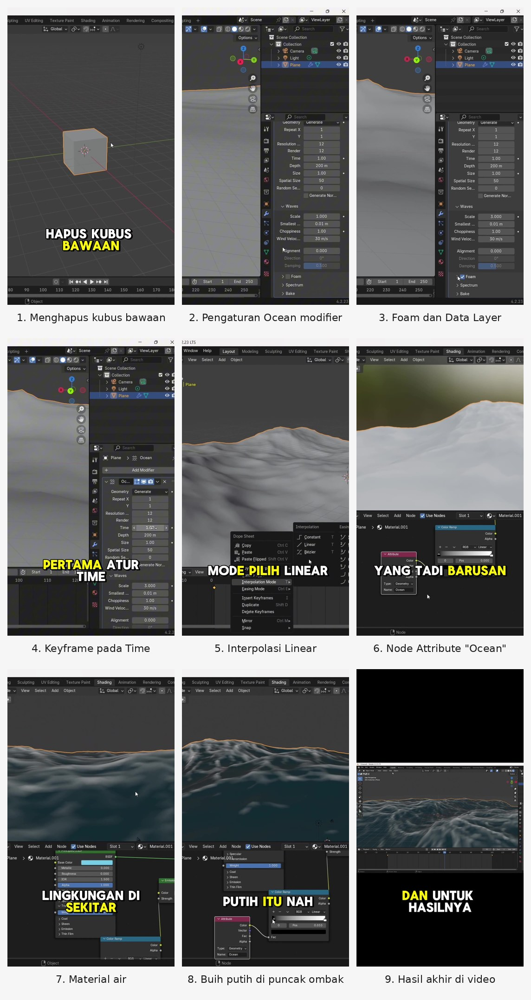
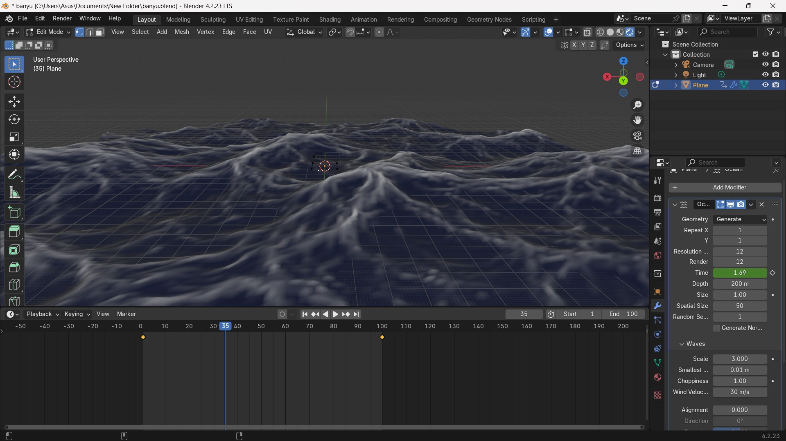

# Cara Membuat Animasi Gelombang Ombak Air di Blender

Video tutorial *screen recording* tentang cara membuat animasi ombak laut di Blender 4.2 LTS. Videonya mencakup pembuatan permukaan laut dengan Ocean modifier, animasi dengan keyframe, sampai material air dengan buih putih di puncak ombak.

| | |
| --- | --- |
| Nama | M. PRASETYABUDI |
| NIM | 1412240044 |
| Mata kuliah | Multimedia (IF562528), Universitas PGRI Ronggolawe Tuban |
| Dosen | Suprapto, S.Kom., M.Kom. |
| Proyek | UTS, Opsi 4: Video/Animation Project (*screen recording tutorial*) |

## Link video

- **Tonton videonya (TikTok):** <https://vt.tiktok.com/ZSpSPKMPa/>
- **Cadangan, file MP4 H.264 1080p (Google Drive):** <https://drive.google.com/drive/folders/1yL7ssGBf3E2_vHG1XxxvJNWJVl-1C_R5?usp=sharing>

## Tujuan belajar

Setelah menonton video ini, penonton bisa:

1. Membuat permukaan laut dengan Ocean modifier.
2. Menggerakkan ombak dengan keyframe pada nilai Time.
3. Membuat material air yang mengilap dan tembus pandang, lengkap dengan buih putih di puncak ombak.

## Isi video

| Waktu | Langkah |
| --- | --- |
| 0:00 | Pembuka |
| 0:07 | Menghapus kubus bawaan dan menambahkan Plane (Shift A → Mesh → Plane), lalu memperbesarnya dengan S |
| 0:22 | Menambahkan Ocean modifier |
| 0:31 | Resolution dan Render: 12 |
| 0:37 | Waves → Scale: 3 |
| 0:47 | Mencentang Foam dan mengisi Data Layer dengan nama `Ocean` |
| 0:57 | Mengubah frame End menjadi 100 |
| 1:06 | Keyframe pada Time: frame 1 bernilai 1, frame 100 bernilai 3 |
| 1:39 | Random Seed: 1 |
| 1:46 | Interpolation Mode → Linear |
| 2:00 | Pindah ke tab Shading dan membuat material baru |
| 2:16 | Menambahkan node Add Shader dan Emission |
| 2:46 | Menambahkan Color Ramp, lalu menyambungkannya ke Strength pada Emission |
| 3:01 | Menambahkan node Attribute (Name: `Ocean`) dan menyambungkannya ke Fac pada Color Ramp |
| 3:18 | Mengatur warna dasar air menjadi kebiruan |
| 3:34 | Roughness: 0 dan Transmission Weight: 1 |
| 3:48 | Menyesuaikan Color Ramp |
| 4:00 | Hasil akhir di viewport |
| 4:13 | Penutup |

## Cara membuka

- **Menonton:** buka link video di atas. File aslinya, `Animasi_Ombak_Blender_H264.mp4`, bisa diputar di pemutar video apa pun, misalnya VLC, Windows Media Player, atau browser.
- **Mencoba sendiri di Blender:** buka Blender 4.2 LTS atau versi yang lebih baru, lalu ikuti langkah di tabel "Isi video" memakai nilai pada tabel di bawah ini.

| Bagian | Pengaturan | Nilai |
| --- | --- | --- |
| Ocean modifier | Resolution (Viewport dan Render) | 12 |
| Ocean modifier | Waves → Scale | 3 |
| Ocean modifier | Foam → Data Layer | `Ocean` |
| Ocean modifier | Random Seed | 1 |
| Timeline | End | 100 frame |
| Ocean modifier | Time (keyframe) | frame 1 = 1, frame 100 = 3 |
| Dope Sheet | Interpolation Mode | Linear |
| Shader | Susunan node | Attribute (`Ocean`) → Color Ramp → Strength pada Emission → Add Shader (bersama Principled BSDF) → Material Output |
| Principled BSDF | Base Color | biru muda atau kebiruan |
| Principled BSDF | Roughness | 0 |
| Principled BSDF | Transmission → Weight | 1 |

## Spesifikasi video

| | |
| --- | --- |
| Format | MP4, video H.264 (High) |
| Resolusi | 1080 x 1920 (vertikal 9:16) |
| Frame rate | 30 fps |
| Durasi | 4 menit 25 detik |
| Ukuran file | sekitar 37 MB |
| Caption | bahasa Indonesia |
| Audio | narasi suara sendiri dan musik latar, volume diratakan |

## Tools yang digunakan

| Tool | Kegunaan |
| --- | --- |
| [Blender 4.2.23 LTS](https://www.blender.org) | Membuat permukaan laut, animasi, dan material air |
| [OBS Studio](https://obsproject.com) | Merekam layar |
| [CapCut](https://www.capcut.com) | Editing, zoom, transisi, caption, efek suara, dan peredam bising |
| [Pinterest](https://id.pinterest.com/) | Mengambil foto CJ untuk video |

## Keputusan desain

- **Format vertikal 9:16** supaya nyaman ditonton di HP dan bisa langsung dibagikan ke media sosial seperti TikTok.
- **Zoom ke panel pengaturan** setiap ada nilai yang diubah, karena tulisan di antarmuka Blender terlalu kecil kalau ditampilkan utuh.
- **Caption besar dengan kata kunci berwarna kuning** supaya istilah penting mudah ditangkap, termasuk saat video ditonton tanpa suara.
- **Resolution Ocean 12:** detailnya cukup halus, tapi Blender tetap ringan dijalankan di laptop.
- **Interpolasi Linear** supaya kecepatan ombak tetap sama dari awal sampai akhir, tanpa melambat di frame pertama dan terakhir.
- **Buih dari data Foam:** Data Layer `Ocean` dibaca oleh node Attribute, lalu diteruskan lewat Color Ramp ke Emission, sehingga puncak ombak tampak putih bersinar.
- **Roughness 0 dan Transmission 1** supaya air terlihat mengilap, tembus pandang, dan memantulkan lingkungan di sekitarnya.
- **Ekspor SDR** (Smart HDR di CapCut dimatikan) supaya warnanya sama di semua layar.

## Kendala dan solusi

Pengerjaan di Blender dan proses editing berjalan lancar.

## Screenshot



Hasil akhir di layar penuh:



Setiap screenshot juga tersedia sebagai file terpisah di folder `screenshots/`.

## Struktur repository

```
.
├── README.md
├── naskah/
│   └── naskah_narasi.md      naskah dan storyboard acuan
└── screenshots/              kolase dan 10 screenshot hasil akhir
```

## Musik dan aset

- **Musik latar:** Funny Quirkly – Redafs, sumber: <https://vt.tiktok.com/ZSpSA5BGN/>
- **Font dan template caption:** bawaan CapCut.
- **Rekaman layar dan suara narasi:** dibuat sendiri.
- **Foto CJ:** karakter dari game *Grand Theft Auto: San Andreas* (Rockstar Games), sumber gambar: <https://pin.it/5Rvm2x6wu>


## Referensi

1. Blender Manual. [Ocean Modifier](https://docs.blender.org/manual/en/4.5/modeling/modifiers/physics/ocean.html).
2. Blender 4.2 Manual. [Keyframes: Introduction](https://docs.blender.org/manual/en/4.2/animation/keyframes/introduction.html).
3. Blender 4.2 Manual. [F-Curve Editing: Interpolation Mode](https://docs.blender.org/manual/en/4.2/editors/graph_editor/fcurves/editing.html).
4. Blender 4.2 Manual. [Principled BSDF](https://docs.blender.org/manual/en/4.2/render/shader_nodes/shader/principled.html).
5. Blender Manual. [Attribute Node](https://docs.blender.org/manual/en/4.3/render/shader_nodes/input/attribute.html).
